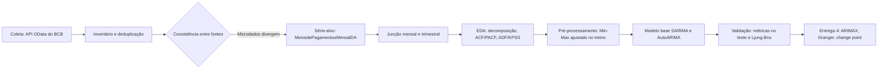

# Previsão de Crescimento e Mensuração do Efeito de Substituição do Pix sobre os Meios de Pagamento Concorrentes no Brasil

> **Projeto Aplicado IV — Curso de Ciência de Dados**
> **Universidade Presbiteriana Mackenzie** (São Paulo, 2026)
> **Status:** Entrega 3 (implementação parcial, 26/10/2026) concluída. Entrega final prevista para 30/11/2026.

---

## 👥 Integrantes da Equipe

- **Cainã Fernandes Guimarães da Silva**
- **Gabriel de Oliveira Meloni**
- **Humberto Guttau Bravo**
- **Jimmy Paiva Gomes**

---

## 📌 Visão Geral do Projeto

Este projeto insere-se na área de **Ciência de Dados aplicada a séries temporais financeiras**. O foco é modelar a adoção do **Pix** (sistema de pagamentos instantâneos do Banco Central do Brasil, lançado em novembro de 2020) e quantificar seus efeitos de substituição e complementaridade sobre outros instrumentos de pagamento: *boleto bancário, cheque, TED/DOC e cartões de crédito, débito e pré-pago*.

### 🎯 Problema de Pesquisa

> **Em que medida o Pix efetivamente substituiu cada um dos meios de pagamento concorrentes, e em que medida ele os complementou por meio da expansão da base de usuários bancarizados?**

A hipótese de trabalho é que o efeito é **heterogêneo**: substituição para alguns instrumentos e complementaridade (bancarização) para outros.

---

## 💡 Motivação e Contexto

1. **Disputa internacional.** Em 2025, o Escritório do Representante Comercial dos EUA (USTR) abriu investigação sob a Seção 301 do *Trade Act* que inclui os serviços de pagamento eletrônico. A determinação de 2026 questiona o Pix por ser regulado e operado pelo próprio Banco Central.
2. **Substituição vs. complementaridade.** Segundo a Abecs, o setor de cartões movimentou R$ 4,5 trilhões em 2025 (+10,1% sobre 2024, com +14,5% no crédito). Isso sugere uma relação mais complexa do que a simples substituição. A literatura (Sampaio e Ornelas, 2024; Balan, Klotzle e Norden, 2026) aponta complementaridade com cartões e efeitos de inclusão financeira.
3. **Lacuna metodológica.** A evidência existente é em boa parte descritiva. Falta uma abordagem quantitativa e reprodutível que isole o efeito do Pix da tendência natural de cada série.
4. **Achado exploratório (ticket médio).** Na estatística mensal do BCB, o ticket médio por transação Pix caiu de **R$ 888 (nov/2020)** para **R$ 410 (nov/2023)**, atingiu o mínimo de **R$ 392 (fev/2024)** e oscila entre R$ 392 e R$ 480 desde então (R$ 477 em jul/2026). É compatível com incorporação de novos usuários e de casos de uso de menor valor, mas **não prova**, isoladamente, inclusão financeira.

O projeto contribui para os ODS 8 (Trabalho Decente e Crescimento Econômico) e 9 (Indústria, Inovação e Infraestrutura). A metodologia (ARIMAX de intervenção, Granger e detecção de pontos de mudança) é replicável para outras inovações de pagamento e outros países.

---

## 🎯 Objetivos

- [x] **a) Previsão do Pix:** modelar a trajetória de adoção via SARIMA, com ordem definida por AutoARIMA e comparada ao modelo base `SARIMA(0,1,0)(0,1,1,12)`.
  - *Status:* concluído para a Entrega 3 (ver [Resultados](#-resultados-da-entrega-3)).
- [ ] **b) Cenários contrafactuais:** construir modelos `ARIMAX` com variável de intervenção para estimar a trajetória projetada dos concorrentes (sem Pix) contra a observada. Os cartões entram agora que a série foi reconstruída.
- [ ] **c) Validação estatística:** aplicar testes de **Causalidade de Granger** e **detecção de pontos de mudança** (*change point detection*).

---

## 🔁 Pipeline da Solução



---

## 📊 Descrição das Bases de Dados

Todas as fontes são primárias, públicas e consumidas via **API OData (Plataforma Olinda)** do Banco Central, sem autenticação.

| Endpoint / Fonte | Granularidade / Período | Uso no projeto | Status e tratamento |
| :--- | :--- | :--- | :--- |
| **`MeiosdePagamentosMensalDA`** | Mensal (Nov/2020 – Jul/2026), 69 meses | **Série-alvo** (`quantidadePix`) e concorrentes mensais (TED, cheque, boleto; DOC) | 🟢 Coletado. Vinha com 2.415 linhas (69 × 70 / 2); **deduplicado por mês**. DOC excluído da modelagem por descontinuação |
| **`EstatisticasTransacoesPix`** | Mensal (Nov/2020 – Jul/2026) | Ticket médio e perfil de uso (microdados) | 🟢 Coletado. O arquivo bruto (1,43 GB, 28.354.037 linhas) tem respostas sobrepostas; **só as 728.009 primeiras linhas são válidas** (gravadas em Parquet, 8 MB) |
| **`Quantidadeetransacoesdecartoes`** | Trimestral (4T20 – 1T26), 22 trimestres | Concorrentes (crédito, débito e pré-pago) | 🟢 Coletado. Trimestre original havia sido sobrescrito; **série reconstruída** por diferença entre rótulos consecutivos. 2T26 fora da série até confirmação |
| **`MeiosdePagamentosTrimestralDA`** | Trimestral | — | 🟡 Não utilizada. Erro 500 do servidor do BCB em todos os trimestres testados |

### ⚠️ Problemas de dados identificados (e como foram tratados)

A API devolve, a cada consulta, o período pedido **e todos os seguintes**. Como a coleta repetiu a consulta período a período e gravou tudo, as bases ficaram com linhas repetidas. Os principais pontos:

- **Microdados do Pix:** a razão entre a quantidade dos microdados e a estatística mensal crescia de ~1 a ~60. A multiplicidade de cada mês é um inteiro exato (1 a 66). Usando só as 728.009 primeiras linhas, a razão fica entre **0,83 e 0,91** (variação de 1,09x). A diferença de 9% a 17% **ainda não tem explicação** e está registrada como limitação. Por isso a série-alvo vem da estatística mensal, na mesma fonte e escala dos concorrentes.
- **Cartões:** o total de transações nacionais por rótulo parecia cair 95% (de ~217 para ~12 bilhões). Após a reconstrução, o valor nacional de 2025 sobre 2024 cresce **15,1% no crédito e 10,7% no total (R$ 4,34 tri)**, consistente com a Abecs (14,5%, 10,1% e R$ 4,5 tri).
- **Armazenamento:** o CSV de 1,43 GB deve ficar no `.gitignore`, pois o GitHub rejeita arquivos acima de 100 MB. O Parquet de 8 MB cabe no repositório.

---

## 📈 Resultados da Entrega 3

### Crescimento relativo (índice base 100 = 1T21)

| Trimestre | Pix | TED | Cheque | Boleto | Crédito | Débito | Pré-pago |
| :--- | ---: | ---: | ---: | ---: | ---: | ---: | ---: |
| 1T22 | 492,8 | 73,2 | 83,8 | 105,6 | 142,4 | 119,5 | 260,0 |
| 1T24 | 1574,3 | 58,1 | 55,9 | 105,5 | 183,0 | 131,5 | 474,3 |
| 1T26 | 2443,5 | 54,8 | 35,7 | 99,1 | 234,7 | 132,0 | 568,9 |
| 2T26 | 2658,5 | 55,5 | 33,9 | 101,1 | — | — | — |

Descrição, e não efeito causal: o Pix chega a ~27x o nível inicial, **TED e cheque caem**, o **boleto fica estável**, **crédito e pré-pago crescem** e o **débito estagna**. Essa é a hipótese a testar na Entrega 4.

### Série-alvo e estacionariedade

- Quantidade de transações Pix: de 32,9 milhões (nov/2020) para 7,98 bilhões (jul/2026); valor de R$ 29,2 bilhões para R$ 3,80 trilhões.
- Decomposição **multiplicativa** (a sazonalidade cresce com o nível): fator sazonal máximo em dezembro (1,10) e mínimo em fevereiro (0,91).
- A série em nível não é estacionária. Só a combinação **d = 1 e D = 1 (s = 12)** é aceita por ADF e KPSS.

### Modelos (treino: nov/2020–jul/2025; teste: ago/2025–jul/2026)

| Modelo | Ordem | AIC | MAPE (%) | RMSE (milhões) | MAE (milhões) | Ljung-Box (lag 12 / 24) |
| :--- | :--- | ---: | ---: | ---: | ---: | :--- |
| SARIMA base | (0,1,0)(0,1,1,12) | −158,3 | 2,42 | 206,8 | 179,8 | 0,68 / 0,11 |
| **AutoARIMA** | **(0,1,0)(1,1,1,12)** | **−237,4** | **1,38** | **123,7** | **99,9** | 0,79 / 0,36 |

- O **AutoARIMA** é adotado como referência para a Entrega 4. O modelo base subestima o observado em 11 dos 12 meses de teste (erro médio −2,4%, contra −0,3% do AutoARIMA).
- O ajuste divergente da versão anterior do modelo base (MAPE de 1,52%) **não é válido**. Com a invertibilidade imposta, o ajuste converge.
- O normalizador Min-Max é ajustado **somente no treino**, para evitar vazamento de dados.

### Limitações

- Diferença não explicada de 9% a 17% entre microdados e estatística mensal.
- Série de cartões com apenas 22 observações e 2T26 não confirmado.
- Horizonte de teste de 12 meses e 57 meses de treino. O coeficiente AR sazonal (0,95) é próximo de 1 e deixa o ajuste sensível ao otimizador (outro ambiente deu MAPE de 1,54%, mantendo a vantagem sobre o modelo base).
- Os modelos desta entrega são univariados e descrevem só a trajetória do Pix.

---

## 🗓️ Cronograma

| Etapa | Período | Situação |
| :--- | :--- | :---: |
| 1. Concepção do produto e organização | 04/08 a 31/08/2026 | ✅ Concluída |
| 2. Caracterização e técnicas de investigação | 01/09 a 28/09/2026 | ✅ Concluída |
| 3. Modelagem e implementação parcial | 29/09 a 26/10/2026 | ✅ Entrega atual |
| 4. Análise crítica, produto e entrega final | 27/10 a 30/11/2026 | ⏳ Pendente |

**Próximos passos (Etapa 4):**

1. **A1:** investigar a razão de 0,83 a 0,91 entre microdados e estatística mensal.
2. **A2:** confirmar o 2T26 da série de cartões.
3. Contrafactuais com ARIMAX de intervenção para cada concorrente, incluindo cartões.
4. Causalidade de Granger e detecção de pontos de mudança.
5. Repetir o diagnóstico de resíduos no modelo final, análise crítica, vídeo e documentação final.

---

## 🛠️ Como Reproduzir

O notebook principal é **`analise_exploratoria_entrega3.ipynb`**. Ele lê os CSVs já gravados e **não** acessa a API por padrão (`RECOLETAR = False`).

```bash
pip install pandas numpy matplotlib statsmodels pmdarima scikit-learn requests pyarrow
jupyter notebook analise_exploratoria_entrega3.ipynb
```

- Mantenha `RECOLETAR = False`. As funções de coleta corrigidas **não foram testadas contra a API**. Se forem executadas, confira que cada mês e cada trimestre aparece uma única vez.
- A última célula gera `log_execucao.txt`, um resumo compacto da execução (ambiente, diagnósticos, tabelas e métricas).
- Os resultados numéricos podem variar um pouco entre versões das bibliotecas, mas a ordem escolhida pelo AutoARIMA é a mesma.

---

## 📚 Documentos e Referências

- Relatório completo: `Projeto Aplicado IV.docx` / `.pdf` (referencial teórico, cronograma e discussão).
- Repositório: <https://github.com/HGuttau/Projeto-Faculdade---Grupo-5>
- Dados: [Estatísticas do Pix](https://dadosabertos.bcb.gov.br/dataset/pix) e [Estatísticas de Meios de Pagamento](https://dadosabertos.bcb.gov.br/dataset/estatisticas-meios-pagamentos) (BCB).

Referências principais: Sampaio e Ornelas (2024); Balan, Klotzle e Norden (2026); Schapiro, Mouallem e Dantas (2023); Box e Jenkins; Box e Tiao (1975); Dickey e Fuller (1979); Kwiatkowski et al. (1992); Granger (1969); Hyndman e Khandakar (2008); Ljung e Box (1978); CNN Brasil/Abecs (2026); USTR (2025, 2026). A lista completa está no relatório.
